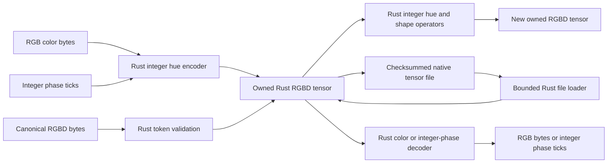

# Architecture

Open the [offline architecture explorer](docs/architecture/index.html) for a source-backed map. It has subsystem drilldown, search, directional relationships, flow filters, data ownership, trust boundaries and failure views. A parallel component list and relationship table provide the same graph as text. Each source link opens actual file contents at the referenced line with a SHA-256 identity.

Run `python scripts/architecture.py --build` after source changes. Run `python scripts/architecture.py --check` to detect stale output, source symbol or hash drift and changes to the reviewed semantic registry. `python -m pytest tests/test_architecture.py` checks those rejection paths. The generated [graph JSON](docs/architecture/graph.json) keeps lexical import discovery separate from reviewed runtime relationships. Validation protects that review from drift. It does not automatically prove that a semantic assertion is correct.

Open `docs/architecture/index.html` directly for offline use, or run `python -m http.server 8877 --bind 127.0.0.1` at the repository root and visit `http://127.0.0.1:8877/docs/architecture/index.html`. Source snapshots require no server. Repository file links work when the server exposes the repository root.

The primary tensor stores canonical RGBD hues in an owned Rust buffer. The Python class is a standard-library `ctypes` binding to that library. Python does not implement its encoder, decoder or tensor arithmetic. The standalone native package does not depend on PyTorch or NumPy.

## Execution path

The Rust crate is [native/hue_tensor](native/hue_tensor/). `lib.rs` implements tokens, constructors, shape operations and arithmetic. `ffi.rs` exposes the C ABI. `storage.rs` implements portable files and streaming SHA-256. `src/bin/hue_tensor.rs` provides the standalone `hue-tensor-cli` executable. The crate has no external dependencies.

The authoritative Python binding is [chromatensor/hue.py](chromatensor/hue.py). The builder copies that exact file into the `chromatic_hue` wheel with the platform library, Rust sources and C header. `Tensor` and `ColorTensor` are aliases of `HueTensor`. The source package imports legacy numerical modules only when a caller requests their names.

## Token domain

`Token` has C-compatible layout with four uint8 fields, R, G, B and D. R, G and B select one of 1,530 canonical saturated RGB colors. Six RGB cube edges form the wheel, with 255 steps per edge and no duplicate endpoint. D refines each step into 256 positions.

The exact phase is `q = hue_index * 256 + D`, where `0 <= q < 391680`. A tensor stores `Vec<Token>` and its logical shape. It does not retain a second vector of decoded phases or an input scalar tensor. Operators read the token bytes, compute integer phase intermediates, and encode each output into another token. The phase coordinates are finite integer labels for the hue algebra.

Encoding a phase tick preserves its exact position. Encoding RGBD validates canonical colors and keeps the literal bytes. Encoding general RGB computes hue from integer channel differences, rounds to the nearest phase tick, and discards saturation and brightness. Achromatic RGB has no hue and fails.

Every token occupies four physical bytes. There are 391,680 valid tokens, so the encoding has redundancy within that 32-bit container. Measured storage reports must include shape and file overhead separately. A uint32 phase control also uses four payload bytes per element.

## Arithmetic and shape operations

The domain uses the established ring `Z/391680Z`. Addition composes phases around the circle. Subtraction reverses composition. Product multiplies phase ticks modulo the domain. Matrix multiplication and dot product accumulate those modular products. Modular sums reduce selected axes. Integer intermediates prevent product overflow before reduction.

Pure red with D equal to zero is the additive identity. Pure red with D equal to one is the multiplicative identity. The modulus is composite, so nonzero tokens do not all have multiplicative inverses. Division is not an implemented operator. Ring multiplication does not describe physical color mixing.

Rotation adds signed phase ticks modulo the domain. Blend follows the shortest arc with a byte weight, zero for the left endpoint and 255 for the right. An exact half-circle follows the positive arc. The implementation rounds integer steps to the nearest tick.

Elementwise binary operations support trailing-axis broadcasting, including scalar and empty tensors. Matrix multiplication currently accepts two rank-two matrices. Dot accepts identical shapes and contracts all corresponding tokens to a scalar. Reshape, permutation and positive-step slices copy actual token bytes into new owned tensors. They never invoke a scalar codec or floating reconstruction. `.T` reverses axes.

Ranks may not exceed 32. A tensor may contain at most 67,108,864 elements. Constructors verify shape products and token counts before copying inputs or allocating output storage. Invalid shapes, phase ticks, colors, bounds and contraction dimensions return errors. The implementation does not intercept arbitrary NumPy or PyTorch operations.

## Ownership and concurrency

Rust owns each tensor. C callers receive opaque handles and must call `ht_free` exactly once. They must supply valid readable input buffers, writable output buffers and correct capacities. They must not free a handle while another call uses it. The C ABI validates declared sizes and shapes, but cannot establish that an arbitrary C pointer addresses an actual allocation.

The ABI returns zero on success, one for input rejection, two for storage errors, and three after catching a Rust panic. Failed output handles are null. `ht_last_error` is thread-local and stays valid until the next operation on that thread. [The C header](native/hue_tensor/include/hue_tensor.h) states these contracts.

Python holds one native handle per `HueTensor`. Each call acquires reentrant locks for every participating tensor in a fixed object order. This prevents simultaneous `close()` from freeing a handle while `ctypes` has released the GIL for a native operation. Ordered locking also avoids opposing binary operations acquiring their locks in different orders.

Context managers release handles on exit. `close()` is idempotent, and later operations reject a closed tensor. Exporting `.rgbd_bytes`, `.rgb_bytes` or `.phases()` creates a Python copy. These copies and shape or handle overhead are separate from `storage_nbytes`.

## Native persistence

The native file has magic `HUECT`, version and flags, little-endian rank and token count, uint64 dimensions, literal RGBD bytes, and a SHA-256 footer. The loader checks file size before token allocation, enforces caller and element budgets, validates lengths and shape, verifies the checksum and rejects noncanonical colors. It rejects trailing bytes and unsupported versions.

The writer creates a temporary file beside the destination, syncs it, then renames it. A write failure preserves an existing destination. Final rename behavior follows the operating system and filesystem. SHA-256 detects corruption and does not authenticate the author. [native/FORMAT.md](native/FORMAT.md) defines the exact layout.

The default Python file budget is 256 MiB. Maximum payload size and complete-file size differ because the file also contains metadata and a checksum. Python rejects embedded NUL characters in paths before passing UTF-8 C strings to the library.

## Build and verification

`scripts/build_native_hue.py` builds the library and CLI with Cargo in offline mode. Host builds copy the platform library into `chromatensor/_native`. The Windows-to-Linux build uses a pinned Rust container and a separate output directory. The builder writes platform-specific `chromatic-hue` wheels with no third-party runtime dependencies.

Native acceptance requires fresh source identities and actual artifacts. It combines the host suite, Windows and Linux Rust builds, the independent million-token control and cold-process decoder, standalone CLI proof, and eight isolated installed-wheel checks. The installed-wheel environments contain neither PyTorch nor NumPy. The NumPy reference used by the million-token test is an external integer oracle.

The source manifest includes executable Python and Rust code, the C header, build metadata, tests, locks and verification scripts. Prose documentation is outside that manifest. A source or binary change requires fresh receipts. Previous numerical release records remain under `results/history/before-native-hue/`.

The source repository recorded six passing native acceptance gates on source `0baada5d50c2fff69be4900a2b6820b714501b9573beada54059b0331bc7c6f9`. That historical host suite passed 776 Python tests with zero skips. Both native builds passed 26 Rust and CLI tests, and all eight isolated package environments passed. The million-token proof matched the integer oracle, preserved actual file bytes, checked a 32 by 32 contraction, and loaded and rotated the saved file in a process importing neither PyTorch nor NumPy. These records do not establish current acceptance for this changed release tree.

The source repository also recorded passing Windows guide consumers, with source, binary, code and artifact hashes in `artifacts/native/documentation-final.json`. Measured native CPU operators were slower than the equal-payload uint32 control for all seven recorded operations. The historical checks establish declared behavior on those checks and do not establish a performance benefit.

## Legacy numerical comparisons

`ChromaTensor`, scalar codecs, tokenizers, quantized neural layers, cube experiments and the local dashboard remain explicit numerical research APIs. Their RGBD format packs FP32 bits and uses D as an exponent. Native hue tokens use D as a sub-hue position. Their file formats are distinct.

Legacy neural execution uses floating masters, gradients and kernels. Legacy Fourier cubes use floating and complex transforms. Those experiments provide comparison evidence and do not execute the native hue algebra. `scripts/verify.py --legacy --output results/legacy-acceptance.json` selects their eleven research gates and writes a separate report. The older passing release source was `69eb8feebdc26d4e72bd1160ed7e5cf695d5035a65f62edebc1a061061ba1fba`.

Native hue GPU operators, autograd, neural training, real-data generalization, optimized hardware and energy benefits have not been established. The CPU library implements its declared finite color domain. It does not replace all real-number tensor algorithms without changing their mathematics.

## Local application boundaries

The dashboard uses a Python `ThreadingHTTPServer` and local files. The browser requests saved JSON, permitted artifacts and live legacy inspections. It does not dispatch native hue arithmetic. The server checks local Host authorities, exact Origin matches for POST requests, declared body sizes, numerical input limits and resolved artifact paths. These controls are not account authentication.

The reviewed runtime has no account model, sign-in, chat backend, payment processor, Convex database or hosted inference provider integration. Research model inference uses local PyTorch. Dataset loaders may download official image datasets through torchvision and Tiny Shakespeare through a recorded upstream URL. Dataset hashes record the selected bytes and partitions. They do not authenticate an upstream author.

The static architecture explorer contains graph data and source snapshots. It does not call the dashboard, load the native library, run experiments or contact remote services. Its import inventory records lexical dependencies. Its semantic graph describes reviewed behavior and includes the relevant verification code without asserting that those tests passed in the current run.
