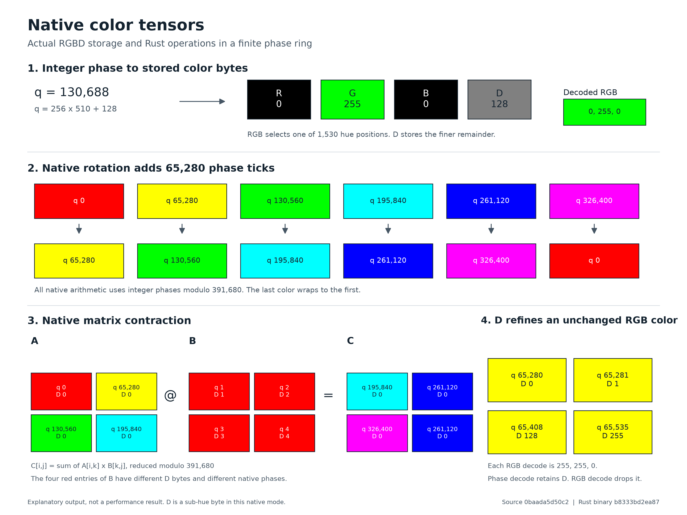

# Chromatic hue tensors

[Documentation website](https://chromatic-hue.netlify.app) · [User guide](https://chromatic-hue.netlify.app/docs/USER_GUIDE.html) · [Architecture explorer](https://chromatic-hue.netlify.app/docs/architecture/index.html) · [Download source](https://chromatic-hue.netlify.app/downloads/chromatic-oss.zip)

This repository provides a Rust tensor whose elements are actual four-byte RGBD color tokens. Python, C, Rust and a standalone CLI can encode colors, compute exact hue operations, change shapes and save bounded, checksummed files. It is useful for researchers and developers studying discrete color arithmetic and inspectable tensor storage.

R, G and B identify a saturated color on a 1,530-color wheel. D divides each color step into 256 positions. The resulting 391,680 phase positions form the established finite ring `Z/391680Z`. Addition composes phases, multiplication works modulo 391,680, and matrix contraction uses those operations. The Rust operators do not decode a floating tensor or call PyTorch or NumPy.

Each element occupies 32 physical bits. Ring multiplication does not model paint or light mixing and does not preserve general real-number arithmetic. The recorded native operators were slower than their equal-storage NumPy controls. There is no demonstrated compression, learning, hardware-speed or new-mathematics advantage.



This illustration comes from the historical native implementation. Current candidate verification is recorded separately in [the release audit](docs/RELEASE_AUDIT.md).

## Start with the native package

Use Python 3.11 through 3.14, Rust 1.96.0 and an x86-64 Windows or Linux linker toolchain. From this checkout on Windows:

```powershell
python -m venv .venv-hue
python scripts/build_native_hue.py --test
.venv-hue/Scripts/python.exe -m pip install --no-deps artifacts/packages/native-hue/chromatic_hue-0.1.0-py3-none-win_amd64.whl
.venv-hue/Scripts/python.exe -I scripts/verify_installed_hue.py --output artifacts/local-native-install.json
```

On Linux use `.venv-hue/bin/python` and the `linux_x86_64` wheel. The native wheel has no third-party runtime dependencies. Linux compatibility is limited to the tested glibc environment; macOS, ARM and native GPU execution are not verified.

```python
from chromatic_hue import HueEncoder

with HueEncoder.encode_phases([[1, 2], [3, 4]]) as a:
    with HueEncoder.encode_phases([[5, 6], [7, 8]]) as b:
        with a @ b as answer:
            assert answer.phases() == (19, 22, 43, 50)
            assert answer.rgbd_bytes[:4] == bytes([255, 0, 0, 19])
            assert answer.storage_nbytes == 16
            answer.save("answer.huetensor")
```

Ordinary RGB projection rejects gray and discards saturation and brightness. Canonical RGBD input preserves its bytes. Context managers close owned native handles. File loading validates budgets, shape, canonical colors and corruption. See [the user guide](docs/USER_GUIDE.md) and [native API](docs/NATIVE_HUE.md).

## Included numerical research

The earlier `ChromaTensor`, scalar codecs, tokenizer, quantized neural layers, cubes and local dashboard remain explicit legacy APIs. Their numerical experiments compare equal bit budgets. Color labels alone showed no task accuracy advantage in the recorded controls. Legacy PyTorch training uses floating parameters, gradients and kernels. The Fourier cube is a software FFT representation and does not establish arbitrary missing-data recovery.

Install the research lock using [the developer guide](docs/DEVELOPER_GUIDE.md), then run:

```powershell
.venv/Scripts/python.exe scripts/run_benchmarks.py --profile smoke --device cpu --seeds 7 --tasks scalar periodic precision operators attention --output results/local-smoke.json
.venv/Scripts/python.exe scripts/dashboard.py --results results/local-smoke.json
```

Open `http://127.0.0.1:8765`. The dashboard reads results, runs bounded real-codec inspection and provides Cube Lab. It needs no account or provider credentials. MNIST and CIFAR experiments download their actual datasets when selected. This source release omits raw dataset caches, dataset-derived probe arrays, private logs and prebuilt historical binaries. [Historical receipts](docs/history/results/) retain measurements with sanitization notes. Source scripts regenerate companion artifacts.

Native GPU operators, autograd and native neural training are absent. The project has no accounts, guest passes, payments, chats, Convex backend, model provider or database. Public hosting of the local dashboard is unverified.

## Architecture and verification

The [architecture explorer](docs/architecture/index.html) has source-backed views, flow selection, search, filters, pan, zoom and a text equivalent. It works without a production backend or CDN. From the root:

```powershell
python scripts/architecture.py --build
python scripts/architecture.py --check
python -m http.server 8877 --bind 127.0.0.1
```

Open `http://127.0.0.1:8877/docs/architecture/index.html`. [Architecture](ARCHITECTURE.md), [testing](docs/TESTING.md), [release instructions](docs/RELEASE_GUIDE.md), [configuration](docs/CONFIGURATION.md) and [the release audit](docs/RELEASE_AUDIT.md) give commands and measured scope.

```powershell
.venv/Scripts/python.exe -m pytest tests -q
cargo fmt --manifest-path native/hue_tensor/Cargo.toml --check
cargo clippy --offline --manifest-path native/hue_tensor/Cargo.toml --all-targets -- -D warnings
python scripts/scan_release.py
```

Historical gates certify their original source only. A configured CI matrix does not prove hosted CI execution. See [the release checklist](RELEASE_CHECKLIST.md) and [research log](RESEARCH_LOG.md).

## License and credit

Copyright 2026 Brad Clonan. Code is licensed under [AGPL-3.0-only](LICENSE). Preserve copyright and license notices. Compliant commercial use is allowed without payment. Paid commercial exceptions require an agreement with the copyright holder; this repository grants no exception. [Licensing guidance](docs/LICENSING.md) explains that boundary. Dependencies retain their own licenses in [third-party notices](THIRD_PARTY_NOTICES.md).
