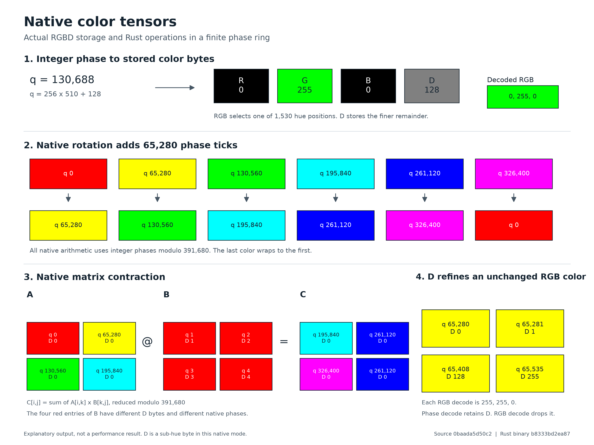

# Native hue tensors

This guide describes the native API. Historical measurements below retain their original source identities. The [release audit](RELEASE_AUDIT.md) records candidate execution. Some historical companion artifacts are omitted; regenerate them with the included scripts.

`Tensor`, `HueTensor` and `ColorTensor` are the same owned Rust tensor. Its elements are actual RGBD color tokens. The Rust library implements the encoder, decoder and operators. The Python package calls its C ABI through `ctypes`, with no third-party runtime dependencies.

This guide covers the native hue implementation. The earlier `ChromaTensor` APIs, scalar RGBD packing and PyTorch models remain numerical comparison tools.

## What a token means

R, G and B identify one of 1,530 saturated RGB colors. Six edges of the RGB cube form a complete hue wheel. Each edge contributes 255 steps. D divides a color step into 256 sub-hue positions. It is not an exponent or image depth in this format.

The exact phase tick is `q = hue_index * 256 + D`. The domain has 391,680 positions, numbered zero through 391,679.

| RGBD bytes | Phase tick | Meaning |
| --- | --- | --- |
| `[255,0,0,0]` | 0 | Red, additive identity |
| `[255,0,0,1]` | 1 | First sub-hue position, multiplicative identity |
| `[255,1,0,0]` | 256 | Next canonical color after red |
| `[0,255,0,0]` | 130560 | Green |
| `[0,0,255,0]` | 261120 | Blue |
| `[255,0,1,255]` | 391679 | Last position before wrapping to red |

RGBD constructors preserve canonical token bytes. Phase constructors encode integer ticks. RGB constructors project general RGB to the hue wheel with integer channel arithmetic. They discard saturation and brightness. Gray has no hue and raises an error. Projecting `[128,0,0]` yields `[255,0,0,0]`, so this projection does not preserve arbitrary source RGB bytes.

Each token occupies four physical bytes. The 391,680-symbol domain leaves redundancy in that 32-bit container. Decoding a phase exports an integer position. It does not reconstruct a floating scalar or retain a cached input.



This illustration comes from the original checkout. Its companion receipt is omitted. The color previews omit D, while the labels retain the phase. Use the candidate proof in `results/native-hue-verification.json` for current execution evidence.

## Install a platform wheel

Use an x86-64 Python interpreter. The release checks cover Python 3.11 through 3.14 on Windows and Linux. The native package does not currently ship macOS or ARM binaries.

Run from the repository root on Windows.

```powershell
python -m venv .venv-hue
python scripts/build_native_hue.py --test
.venv-hue\Scripts\Activate.ps1
python -m pip install --no-deps artifacts/packages/native-hue/chromatic_hue-0.1.0-py3-none-win_amd64.whl
python -c "from chromatic_hue import native_info; print(native_info())"
```

On Linux, install the Linux wheel.

```bash
python3 -m venv .venv-hue
python3 scripts/build_native_hue.py --test
source .venv-hue/bin/activate
python -m pip install --no-deps artifacts/packages/native-hue/chromatic_hue-0.1.0-py3-none-linux_x86_64.whl
python -c 'from chromatic_hue import native_info; print(native_info())'
```

The wheels contain the standard-library binding, the platform library, Rust sources and C header. Their package name is `chromatic-hue`, and their import name is `chromatic_hue`. Linux compatibility depends on the build's glibc requirements. A `linux_x86_64` tag is not a claim that every Linux distribution can load it.

The historical Windows wheel had 138,710 bytes and SHA-256 `5f0338cd1d8af65d2f5b8e3564d899fc031b33d9564942143d5f7c50c064584f`. Its Linux counterpart had 248,094 bytes and SHA-256 `0531040085baf3bc25645c389e46479350f6fc866eb78a3b65d6d2869ac90e2e`. The [archived package receipt](history/results/native-hue-package-verification.json) describes those original builds. Current wheels include additional attribution files. See the release audit for their hashes and executed package checks.

## Build from source

The native build requires Python 3.11 or newer, Cargo, Rust and a working platform linker. Windows uses the Rust MSVC target and its Visual C++ build tools. Run this command from the checkout.

```text
python scripts/build_native_hue.py --test
```

The builder runs Rust tests, builds the release library and CLI, copies the library into `chromatensor/_native`, and writes a wheel under `artifacts/packages/native-hue/`. Build outputs go under `artifacts/native-build-host/`. Cargo runs with `--offline` because the crate has no external dependencies. Initial Rust and linker installation is separate from that offline build.

The Windows-to-Linux build uses Docker with a pinned image.

```text
python scripts/build_native_hue.py --platform linux --test
```

The image is `rust:1.96.0-slim-bookworm@sha256:4732ca96fd086cb9be682050c3f0176288eebaac2b80aa2bcefccfaf198e1950`. Docker may need to download it once. Compilation runs with container networking disabled and writes to `artifacts/native-build-linux/`. The repository mount is read-only.

When using the checkout directly, import from `chromatensor`. When using the standalone wheel, import from `chromatic_hue`. They expose the same native classes from the authoritative `chromatensor/hue.py` binding. An editable install of the full numerical research project also installs its legacy ML dependencies and is unnecessary for the native package.

## Encode, compute and decode in Python

This example uses actual color bytes as the left matrix. D changes the represented phase even when the coarse RGB display is identical.

```python
from chromatic_hue import Tensor, HueEncoder, HueDecoder

colors = bytes([
    255, 0, 0, 1,
    255, 0, 0, 2,
    255, 0, 0, 3,
    255, 0, 0, 4,
])

with HueEncoder.encode_rgbd(colors, (2, 2)) as a:
    with HueEncoder.encode_phases([[5, 6], [7, 8]]) as b:
        with a @ b as result:
            assert result.shape == (2, 2)
            assert result.phases() == (19, 22, 43, 50)
            assert result.rgbd_bytes[:4] == bytes([255, 0, 0, 19])
            assert HueDecoder.decode_rgb(result) == bytes([255, 0, 0] * 4)
            assert HueDecoder.decode_phases(result) == (19, 22, 43, 50)
            assert result.storage_nbytes == 16
            assert result.save("answer.huetensor") == 88

with Tensor.load("answer.huetensor", max_bytes=1024) as restored:
    assert restored.phases() == (19, 22, 43, 50)
```

For a separate-process decoder, run this command after the example has saved its file.

```text
python -c "from chromatic_hue import Tensor; t = Tensor.load('answer.huetensor', max_bytes=1024); print(t.phases()); t.close()"
```

No encoder input passes to that process. The Rust loader reconstructs the tensor from shape metadata and the stored RGBD bytes.

The `HueEncoder` methods are `encode_rgb`, `encode_rgbd` and `encode_phases`. `HueDecoder.decode_rgb` returns three-byte color previews. `HueDecoder.decode_phases` returns exact integer ticks. `.rgbd_bytes` exports all four stored channels. Those exports copy data to Python and are separate from native payload accounting.

## Arithmetic and shape operations

The arithmetic domain is the established finite ring `Z/391680Z`. It uses exact integer operations and modular reduction. The color encoding supplies its token representation and hue geometry.

| Operation | Behavior |
| --- | --- |
| `a + b` | Add phase ticks modulo 391,680 |
| `a - b` | Subtract phase ticks modulo 391,680 |
| `a * b` | Multiply phase ticks modulo 391,680 |
| `a @ b` | Rank-two modular matrix contraction |
| `a.dot(b)` | Contract all tokens in identically shaped tensors, with modular arithmetic |
| `a.sum(axis)` | Modular reduction along an axis |
| `a.sum()` | Modular reduction to one scalar |
| `a.rotate(ticks)` | Add signed ticks around the hue wheel |
| `a.blend(b, weight)` | Follow the shortest hue arc with a weight in zero through 255 |
| `a.reshape(...)` | New shape with the same token count |
| `a.permute(...)` | Reorder axes and token bytes |
| `a.T` | Reverse all axes |
| `a.slice(axis, start, stop, step)` | Positive-step slice with bounds inside the axis |

Binary elementwise operations and blend support trailing-axis broadcasting. Phase values and shape arguments must be integers. Boolean and floating phase inputs fail. Reshape does not infer a dimension from `-1`. Slices do not implement arbitrary Python indexing or negative steps.

Blend weight zero returns the left color. Weight 255 returns the right color. An exact half-circle follows the positive arc. Integer rounding chooses the nearest tick. Ring product is a modular operation and does not model physical color mixing. The composite modulus also means some nonzero tokens have no multiplicative inverse. Division is not implemented.

```python
from chromatic_hue import Tensor, PHASE_MODULUS

with Tensor.from_phases([PHASE_MODULUS - 1, 256]) as colors:
    with colors.rotate(1) as rotated:
        assert rotated.phases() == (0, 257)
    with colors.reshape(1, 2) as matrix:
        with matrix.T as transposed:
            assert transposed.shape == (2, 1)
    with colors.slice(0, 1, 2) as selected:
        assert selected.rgbd_bytes == bytes([255, 1, 0, 0])
```

Every result owns a new Rust tensor. The implementation has CPU operators. Native GPU execution, autograd and neural training are not implemented or verified.

## Ownership and shutdown

Use `with` to release a tensor when its work ends. `close()` releases its native allocation and may be called more than once. Operations on a closed tensor raise an error. The destructor also attempts cleanup, but explicit lifetime control gives predictable release.

The Python binding acquires ordered reentrant locks around native calls. This keeps a handle alive when `ctypes` releases the GIL and another thread calls `close()`. It also orders the locks for two-input operations. C callers must arrange their own synchronization and must never free a handle during a call.

The native package starts no server or background process. A CLI command releases its data when the process exits. Use `deactivate` to leave the Python environment after work.

## Use the standalone CLI

The builder writes `artifacts/native-build-host/release/hue-tensor-cli.exe` on Windows. Linux builds write `hue-tensor-cli` in the selected build output directory. The executable works without Python.

```powershell
$hueCli = ".\artifacts\native-build-host\release\hue-tensor-cli.exe"
& $hueCli encode 2x2 0,256,131072,391679
& $hueCli decode 2 "255,0,0,0;255,1,0,255"
& $hueCli save left.huetensor 2x2 256,65536,131072,196608
& $hueCli save right.huetensor 2x2 32768,98304,262144,390000
& $hueCli matmul left.huetensor right.huetensor result.huetensor
& $hueCli read result.huetensor 1048576
& $hueCli demo proof.huetensor
```

Commands print actual RGBD rows and exact integer phases as JSON. `demo` checks matrix multiplication against a separate integer phase calculation, mutates a stored D byte, checks the changed result, then saves and reloads it. Giving an output path keeps the result for a separate `read` process. Invalid input exits with status two and prints the reason to stderr.

The CLI also supports `add`, `sub`, `product`, `rotate`, `blend` and `sum`. Run `hue-tensor-cli --help` for their argument order. `scalar` names a rank-zero shape, dimensions use a form such as `2x2`, and `-` names an empty token list.

## Use the Rust library

A Rust consumer can depend on the local crate without third-party packages.

```toml
[dependencies]
hue_tensor = { path = "path/to/chromatic/native/hue_tensor" }
```

```rust
use hue_tensor::{storage, Tensor, Token};
use std::path::Path;

fn main() -> hue_tensor::Result<()> {
    let a = Tensor::from_rgbd(
        vec![
            Token::new(255, 0, 0, 1)?,
            Token::new(255, 0, 0, 2)?,
            Token::new(255, 0, 0, 3)?,
            Token::new(255, 0, 0, 4)?,
        ],
        vec![2, 2],
    )?;
    let b = Tensor::from_phases(vec![5, 6, 7, 8], vec![2, 2])?;
    let result = a.matmul(&b)?;
    assert_eq!(result.phases(), vec![19, 22, 43, 50]);
    storage::save_tensor(&result, Path::new("answer.huetensor"))?;
    let loaded = storage::load_tensor(Path::new("answer.huetensor"), 1024)?;
    assert_eq!(loaded.tokens(), result.tokens());
    Ok(())
}
```

Rust drops each owned tensor when it leaves scope. Constructors validate canonical tokens, phase bounds and shape counts. The crate limits rank to 32 and element count to 67,108,864.

## Use the C ABI

[hue_tensor.h](../native/hue_tensor/include/hue_tensor.h) declares the ABI. A caller owns each opaque `ht_tensor` handle, supplies valid buffers with their exact capacities, and calls `ht_free` once. Status zero succeeds. Status one rejects input, two reports storage failure, and three catches a Rust panic. An output handle is null on failure. Read `ht_last_error` before the next API operation on that thread.

```c
#include "hue_tensor.h"
#include <stdio.h>

int main(void) {
    const uint32_t a_values[4] = {1, 2, 3, 4};
    const uint32_t b_values[4] = {5, 6, 7, 8};
    const size_t shape[2] = {2, 2};
    ht_tensor *a = NULL, *b = NULL, *result = NULL;
    uint8_t rgbd[16];
    int status = ht_new_phases(a_values, 4, shape, 2, &a);
    if (!status) status = ht_new_phases(b_values, 4, shape, 2, &b);
    if (!status) status = ht_matmul(a, b, &result);
    if (!status) status = ht_copy_tokens(result, rgbd, sizeof rgbd);
    if (status) {
        fprintf(stderr, "%s\n", ht_last_error());
    } else {
        printf("%u,%u,%u,%u\n", rgbd[0], rgbd[1], rgbd[2], rgbd[3]);
    }
    ht_free(result);
    ht_free(b);
    ht_free(a);
    return status ? 1 : 0;
}
```

Save it as `hue_example.c`. In a Windows developer command prompt, link the generated import library and write the executable beside its DLL.

```text
cl /nologo /I native\hue_tensor\include hue_example.c /Fe:artifacts\native-build-host\release\hue-example.exe /link artifacts\native-build-host\release\hue_tensor.dll.lib
artifacts\native-build-host\release\hue-example.exe
```

On Linux after a host build, link the shared library and set its search path for the command.

```bash
cc -std=c11 -I native/hue_tensor/include hue_example.c -L artifacts/native-build-host/release -lhue_tensor -o hue-example
LD_LIBRARY_PATH="$PWD/artifacts/native-build-host/release" ./hue-example
```

The first output token is `255,0,0,19`. These compile commands require a C compiler. The candidate Windows C consumer produced that output. Its Rust consumer checked phases `[19,22,43,50]` and an 88-byte file round trip. [Documentation evidence](evidence/documentation-examples.json) records the executed snippets, source identity and outputs. The Linux C recipe remains a reproduction instruction.

## Files, backup and updates

[The native format](../native/FORMAT.md) stores a 24-byte fixed header, eight bytes per shape dimension, four bytes per token and a 32-byte SHA-256 footer. A two by two tensor therefore takes 88 bytes, with 16 payload bytes. A rank-one million-token file takes 4,000,064 bytes. The checksum covers metadata and every token byte.

The loader rejects malformed sizes, unsupported versions, nonzero reserved flags, shape mismatches, invalid colors, corruption and trailing bytes. `max_bytes` applies to the complete file. The Python default is 256 MiB. Raising that limit does not raise the separate rank or element limit. The checksum detects corruption and does not authenticate who created a file.

Save uses an adjacent temporary file, syncs it and renames it to the requested path. A failed write preserves an existing file. Final replacement behavior follows the platform filesystem. Back up source, wheels, receipt JSON files, their referenced artifacts and your `.huetensor` files together. A filename extension does not change the format.

After updating executable source, rebuild the native binary and wheel, reinstall the wheel into the intended environment, then rerun acceptance. A process that has already loaded a native library should exit before switching versions. `native_info()` reports the loaded library path, SHA-256, byte count, ABI version and phase modulus.

## Verification and troubleshooting

Historical acceptance passed all six native gates on source `0baada5d50c2fff69be4900a2b6820b714501b9573beada54059b0331bc7c6f9`. That host passed 776 Python tests with zero skips, and Windows and Linux each passed 26 Rust and CLI tests. Its eight clean package environments covered four Python versions on each operating system without PyTorch or NumPy. The release audit records the new candidate's separately executed gates.

The historical million-token producer matched RGBD bytes, phases and seven operators against a same-payload uint32 control at seed 7331. It also checked exact 32 by 32 matrix contraction, changed-byte effects and isolated saved-file decoding. Its file had 4,000,000 payload bytes and 64 overhead bytes. Native CPU operators were slower than the NumPy control in that run. [The experiment matrix](../EXPERIMENT_MATRIX.md) keeps historical and candidate timings separate. These checks establish representation correctness and make no performance claim.

The README and current user-guide Python examples executed against the candidate binding without importing PyTorch or NumPy. The candidate's installed package checks independently verify native arithmetic and file round trips. See the release audit for the current scope.

```text
python -m pytest
python scripts/verify_native_hue.py
python scripts/run_native_hue_package_checks.py
python scripts/verify.py
```

`python scripts/verify.py --legacy --output results/legacy-acceptance.json` selects the earlier numerical gates and keeps their report separate from native acceptance. Archived numerical receipts under `docs/history/results/history/before-native-hue/` do not establish candidate acceptance. [TODO.md](../TODO.md), [the experiment matrix](../EXPERIMENT_MATRIX.md) and [research log](../RESEARCH_LOG.md) track actual execution.

| Failure | Action |
| --- | --- |
| Native library is missing | Build from this checkout or install the correct platform wheel |
| Wrong architecture or library load error | Check for x86-64 Python and the correct operating-system wheel; on Linux check glibc compatibility |
| Cargo cannot find its linker | Install the platform build tools and run from their configured terminal |
| Docker Linux build fails before compilation | Start Docker and check that the pinned image is available |
| Canonical hue validation fails | Use `encode_rgb` to project ordinary RGB, or supply exact wheel colors to `encode_rgbd` |
| Gray RGB fails | Choose a policy outside the hue tensor for achromatic input, because gray has no hue |
| Shape or phase error | Check rectangular integer input, phase bounds and element counts |
| File budget error | Inspect the file size, then choose an explicit complete-file budget for that file |
| Checksum error | Keep the failed file and restore a verified backup; do not discard the checksum |
| Closed tensor error | Keep the operation inside its owning context or create a new tensor |
| Acceptance rejects stale evidence | Rebuild and regenerate receipts for the current source and binary |

The library implements a finite hue algebra. It changes the mathematics of conventional tensors. Real-valued neural training, native GPU execution, autograd, real-data learning benefits and optimized hardware remain unverified. Measured timings and correct color-token arithmetic alone do not establish those claims.
